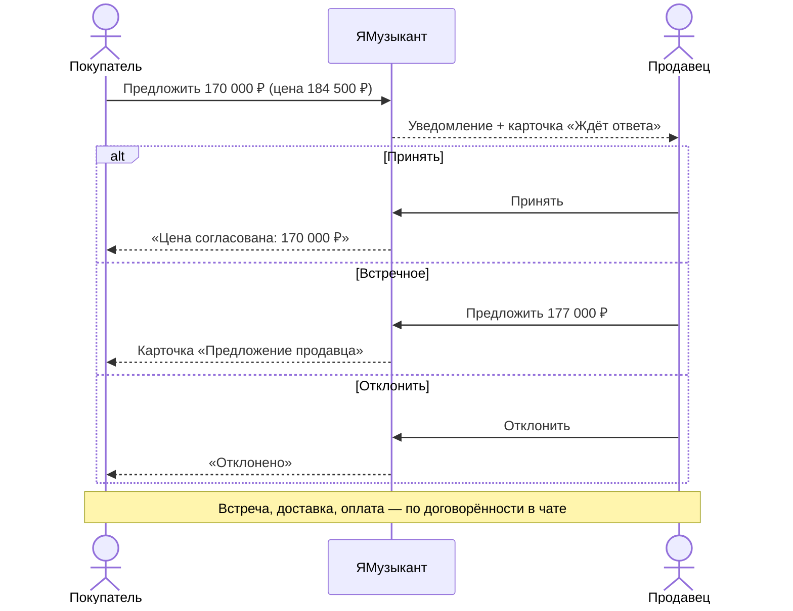
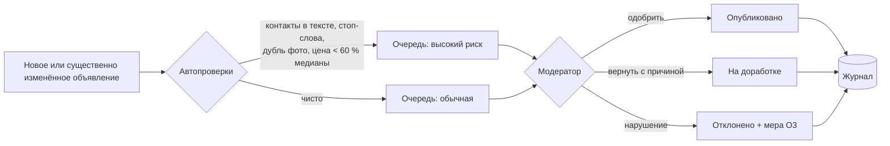
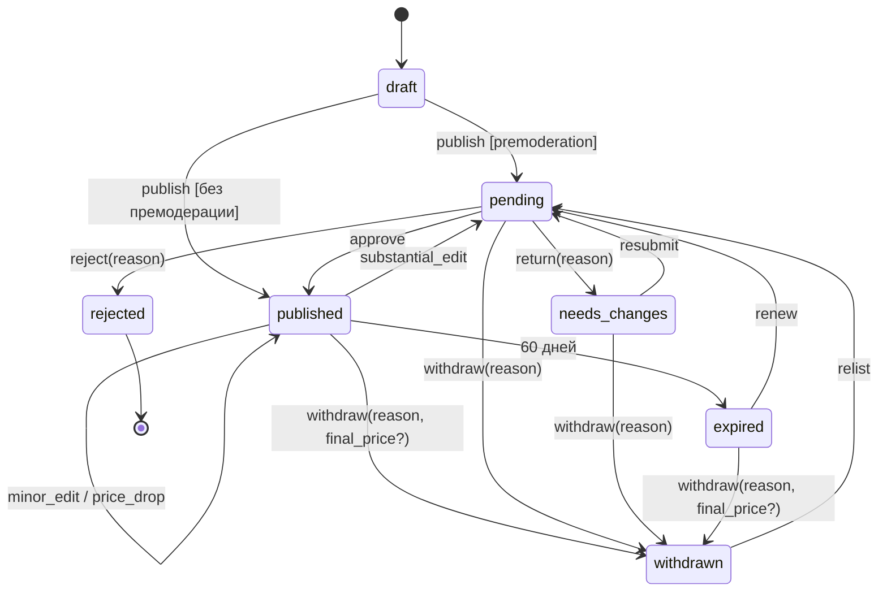
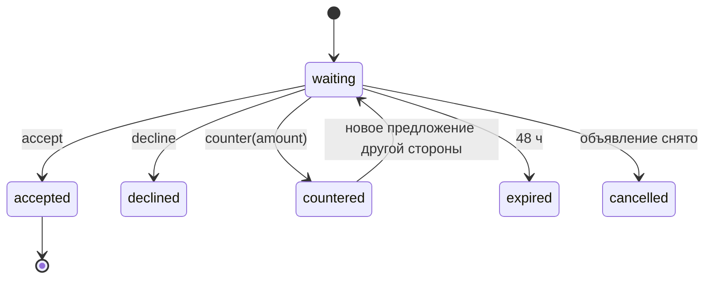

# Спецификация MVP «Барахолка»

Версия 1.1 · основа ТЗ. Изменения 1.1 (02.11.2026, решение OWNER): вход через Яндекс ID и код на почту вместо SMS; публикация объявлений без премодерации до включения флага `premoderation`; чат, избранное и письма о сообщениях — в гейте G1. Значения с пометкой «уточнить» — предположения; до их подтверждения OWNER они живут в конфиге, а не в коде.

## 1. Продукт

ЯМузыкант — площадка объявлений о б/у музыкальных инструментах. Площадка **не проводит оплату**: покупатель и продавец договариваются в сообщениях, деньги и передача — между ними. Ценность MVP: специализированный поиск (виды инструментов, шкала состояния, город), понятная карточка лота, чат с предложением цены и модерация, которая отсекает мошенников.

**Гипотеза MVP:** музыканты быстрее продают и находят б/у инструменты на специализированной площадке, чем на общих досках.
**Метрики (уточнить):** 1 000 опубликованных объявлений за 8 недель после запуска; 30 % объявлений получают сообщение за 7 дней; медиана модерации ≤ 1 ч в рабочее время; ≥ 40 % снятых объявлений — с итоговой ценой.

## 2. Объём

**Входит:** вход через Яндекс ID и по коду на почту; профиль и город; подача объявления (4 шага, фото, черновик); модерация (автопроверки + очередь); Барахолка (поиск, фасеты, сортировка, город); страница лота; страница продавца; главная с рельсами Барахолки; сообщения; предложение цены; избранное; сохранённые поиски; уведомления (почта и центр в шапке); жалобы; помощь; кабинет (обзор, объявления, избранное, поиски, профиль); консоль сотрудников (модерация, обращения, пользователи, справочники, сотрудники, журнал); ошибки 404/500/503; адаптив ≥ 320 px.

**Не входит (после R1):** каталог новых товаров и компании-продавцы; тарифы, баллы, продвижение; мастера, запись, проверка перед покупкой; цены продаж и страница модели; аксессуары и «Мои инструменты»; безопасная сделка и онлайн-оплата; доставка через службы; витрина и рассылки в консоли.

В макетах есть элементы вне MVP — реализацию **не делаем**, места под них скрыты фича-флагами (`docs/03-design/SCREENS.md`).

## 3. Акторы

| Актор | Описание |
|---|---|
| Гость | Смотрит Барахолку, лоты, продавцов, помощь |
| Пользователь | Вошёл через Яндекс ID или по коду на почту: покупает и продаёт, один аккаунт на оба действия; в кабинете — разделы «Покупаю» и «Продаю» |
| Модератор | Проверяет объявления, разбирает жалобы |
| Поддержка | Отвечает на обращения, ограничивает пользователей |
| Администратор | Справочники, сотрудники и права, журнал |

## 4. Use cases

| ID | Сценарий | Актор | Гейт | Экран |
|---|---|---|---|---|
| A1 | Войти через Яндекс ID или по коду на почту | Гость | G1 | окно входа в шапке |
| A2 | Указать имя и город, настроить уведомления | Пользователь | G1 | Кабинет → Профиль |
| A3 | Удалить аккаунт | Пользователь | G3 | Кабинет → Профиль |
| S1 | Выбрать город | Все | G1 | Шапка |
| S2 | Найти объявление запросом или по категории | Все | G1 | Главная, Барахолка |
| S3 | Отфильтровать и отсортировать выдачу | Все | G1 | Барахолка |
| S4 | Сохранить поиск и получать новые лоты | Пользователь | G2 | Барахолка, Кабинет |
| S5 | Добавить в избранное | Пользователь | G1 | Карточка, Лот, Кабинет |
| L1 | Подать объявление | Пользователь | G1 | Продать |
| L2 | Получить решение модерации и исправить | Пользователь | G2 | Кабинет, письмо |
| L3 | Изменить объявление, снизить цену | Пользователь | G1 | Кабинет |
| L4 | Снять с продажи с итоговой ценой | Пользователь | G1 | Кабинет |
| V1 | Посмотреть лот | Все | G1 | Лот |
| V2 | Посмотреть продавца | Все | G1 | Продавец |
| D1 | Написать продавцу | Пользователь | G1 | Лот → Сообщения |
| D2 | Предложить цену | Покупатель | G2 | Сообщения |
| D3 | Ответить на предложение | Продавец | G2 | Сообщения |
| D4 | Пожаловаться на объявление, пользователя или сообщение | Пользователь | G2 | Лот, Продавец, Сообщения |
| H1 | Найти ответ и написать в поддержку | Все | G2 | Помощь |
| N1 | Получать письма и уведомления | Пользователь | G1 — письма о коде, сообщениях и снижении цены в избранном (4.3.1); G2 — остальное и центр уведомлений | Письма, центр уведомлений |
| O1 | Проверить объявление | Модератор | G2 | Консоль → Модерация |
| O2 | Разобрать жалобу или обращение | Модератор, Поддержка | G2 | Консоль → Обращения |
| O3 | Ограничить пользователя | Поддержка, Администратор | G2 | Консоль → Пользователи |
| O4 | Вести справочники | Администратор | G2 | Консоль → Справочники |
| O5 | Управлять сотрудниками и правами | Администратор | G2 | Консоль → Сотрудники |
| O6 | Найти действие в журнале | Администратор | G2 | Консоль → Журнал |

## 5. Ключевые сценарии

### UC-A1. Войти
**Поток:** «Войти» в шапке или действие, которому нужен вход (написать, в избранное, продать) → окно входа. Два способа:
1) «Войти с Яндекс ID» → OAuth Яндекса → возврат на сайт. Почта берётся из Яндекс ID; если аккаунт с этой почтой есть — Яндекс ID привязывается к нему.
2) Почта → «Получить код» → код 6 цифр из письма (TTL 10 мин, уточнить) → вход. Повтор отправки — через 60 с.
**Первый вход** (аккаунта не было): шаг в том же окне — имя (из Яндекс ID, если есть), город (из шапки), согласие с правилами и политикой обработки ПДн (версия документа). Без согласия аккаунт не создаётся.
**Альтернативы:** 1a) Яндекс ID не отдал почту — просим ввести почту и подтвердить кодом; 1b) пользователь отказался в Яндексе — окно входа с текстом «Вход через Яндекс ID отменён» и вариантом входа по почте; 2a) лимит кодов — «Слишком много попыток. Повторите через N мин».
**Приёмка:** код не попадает в логи, ответы API и Sentry; после входа пользователь возвращается к прерванному действию; паролей и входа по телефону нет.


### UC-L1. Подать объявление
**Предусловие:** пользователь вошёл, не ограничен.
**Поток:** 1) вид инструмента (8 видов); 2) бренд и модель — подсказка из справочника; 3) год, серийный номер; 4) фото: минимум 3, одно — серийный номер, максимум 12; 5) состояние (8 ступеней) и описание; 6) цена, «Готов к торгу», способы передачи (встреча в городе / доставка); 7) «Опубликовать» → автопроверки → «Опубликовано» (пока флаг `premoderation` выключен) или «На проверке» (флаг включён).
**Альтернативы:** 2a) модели нет — текстом, уходит в «Предложено продавцами»; 7a) не хватает данных — кнопка неактивна, над ней список недостающего; 7b) «Сохранить черновик» и автосохранение каждые 5 с.
**Приёмка:** превью ListingCard обновляется на лету; серийный номер в публичных данных маскируется (`V09****`); фото без EXIF-геоданных; после отправки — экран «Объявление опубликовано» (или «Отправлено на проверку» при включённой премодерации); контакты в тексте блокируют отправку с подсказкой «Уберите телефон и ссылки из описания — покупатели напишут вам в сообщениях».

### UC-D2/D3. Предложить цену
**Предусловие:** чат по объявлению, объявление опубликовано, продавец отметил «Готов к торгу».
**Поток:** «Предложить цену» → сумма (быстрые −5/−10/−15 %) → комментарий → отправить. Продавец: «Принять», «Предложить свою», «Отклонить».
**Правила:** сумма ≥ цены — отправка заблокирована («просто напишите продавцу»); < 70 % — предупреждение, отправить можно; одно активное предложение на пару покупатель–объявление; истекает через 48 ч (уточнить).
**Приёмка:** после «Принять» в чате системное сообщение «Цена согласована: N ₽» и напоминание «платите после осмотра»; статус у обеих сторон обновляется без перезагрузки (Reverb).



### UC-L4. Снять с продажи
Причина: «Продал на ЯМузыканте», «Продал в другом месте», «Передумал». Для первых двух — необязательное поле «За сколько продали» (подсказка — согласованная цена из чата). Итоговая цена публично не показывается; хранится в `sale_records` для будущих «Цен продаж» и автопроверки «цена ≪ рынка».

### UC-O1. Модерация

**Приёмка:** причина выбирается из справочника и показывается продавцу дословно; решение пишется в журнал с автором; SLA — ≤ 1 ч в 9:00–21:00 мск (уточнить).

## 6. Жизненные циклы

### 6.1 Объявление

Существенная правка — изменение фото, модели, категории, названия, серийного номера, описания, состояния (решение OWNER 04.11.2026). Год, город, цена, «Готов к торгу», способы передачи, порядок фото (смена обложки из уже проверенных фото) — несущественные. Пока флаг `premoderation` выключен, resubmit, renew и relist тоже ведут сразу в `published` (решение OWNER 04.11.2026); снять с продажи можно также из `pending`, `needs_changes` и `expired`, черновик удаляется. Пока флаг `premoderation` выключен, существенная правка проходит автопроверки и остаётся `published`; переходы через `pending` включаются вместе с флагом (гейт G2). Цена вниз и способы передачи — без повторной модерации. Объявление не в `published` (снято, истекло, на проверке, на доработке, черновик) видят только владелец и сотрудники; для остальных страница объявления и его фото — 404, как у отсутствующего (решение OWNER 07.11.2026). Исключение — участники беседы по объявлению: им доступна обложка (без фото серийного номера) для карточки беседы (BR-10).

### 6.2 Предложение цены


### 6.3 Жалоба / обращение
`new → in_progress → waiting_user ⇄ in_progress → resolved`. Жалоба на объявление с ≥ 3 жалобами от разных пользователей за 24 ч автоматически скрывает объявление до решения (уточнить).

### 6.4 Ограничение пользователя
Меры: `warning`, `no_publish` (3/7/30 дней/бессрочно), `blocked`. У каждой — причина, автор, срок, запись в журнале. Заблокированный пользователь не может входить; его объявления — `withdrawn` с причиной `moderation`.

## 7. Данные

```mermaid
erDiagram
  USER ||--o{ LISTING : sells
  USER ||--o{ FAVORITE : ""
  USER ||--o{ SAVED_SEARCH : ""
  USER ||--o{ RESTRICTION : ""
  CITY ||--o{ USER : ""
  CITY ||--o{ LISTING : ""
  CATEGORY ||--o{ CATEGORY : children
  CATEGORY ||--o{ LISTING : ""
  INSTRUMENT_MODEL ||--o{ LISTING : ""
  LISTING ||--o{ LISTING_PHOTO : ""
  LISTING ||--o{ MODERATION_DECISION : ""
  LISTING ||--o| SALE_RECORD : ""
  LISTING ||--o{ CONVERSATION : ""
  CONVERSATION ||--o{ MESSAGE : ""
  CONVERSATION ||--o{ OFFER : ""
  USER ||--o{ COMPLAINT : files
  STAFF ||--o{ ACTIVITY_LOG : writes
  LISTING { uuid id; uuid user_id; string status; int category_id; int model_id; string title; int year; string serial_enc; string condition; text description; int price; bool negotiable; bool meet; bool ship; int city_id; datetime published_at }
  OFFER { uuid id; uuid conversation_id; uuid from_user_id; int amount; string status; datetime expires_at }
  SALE_RECORD { uuid listing_id; string reason; int final_price; date sold_at }
  RESTRICTION { uuid id; uuid user_id; string kind; datetime until; string reason; uuid staff_id }
```
Пользователь: `email` (unique, lower-case), `yandex_id` (unique, nullable), `name`, `city_id`, `notification_prefs`, `consent_version`, `consented_at`. Серийный номер хранится зашифрованным (`encrypted` cast), в индекс и на фронт — только маска.

## 8. Бизнес-правила

- **BR-01** Город выбирается в шапке и применяется ко всей выдаче; фильтром не дублируется. Расстояние показывается, если известна геопозиция.
- **BR-02** Состояние — только 8 ступеней: Новое · Как новое · Отличное · Очень хорошее · Хорошее · Удовлетворительное · Плохое · На запчасти.
- **BR-03** Фото: 3–12, одно — серийный номер; JPEG/PNG/HEIC до 15 МБ; EXIF-геоданные удаляются.
- **BR-04** Почта пользователя никогда не показывается другим пользователям; телефон не собираем; связь — через сообщения. Контакты в тексте объявления блокируют отправку с подсказкой (5.1.1); при включённой премодерации — ещё и «высокий риск» в очереди.
- **BR-05** Предложение цены — одно активное на пару покупатель–объявление; не выше цены объявления.
- **BR-06** Лимит бесплатных активных объявлений частного лица — 10 (уточнить); при превышении — понятный отказ, не скрытая ошибка.
- **BR-07** Все действия сотрудников пишутся в журнал; журнал нельзя изменить или удалить.
- **BR-08** Вход сотрудников — только с двухфакторной аутентификацией.
- **BR-11** Цена объявления — одно из трёх: сумма в рублях; «Договорная» (суммы нет, `price = null`); «Бесплатно» (`price = 0`). Показ «0 ₽» запрещён: `null` → «Договорная», `0` → «Бесплатно». «Готов к торгу» (`negotiable`) — только при указанной сумме. Фильтр цены «от/до» учитывает только объявления с суммой; сортировки по цене ставят «Договорная» в конец (решение OWNER 07.11.2026).
- **BR-10** Начать беседу можно только по объявлению в `published`. Начатая беседа остаётся открытой для обеих сторон всегда, в каком бы статусе ни было объявление (снято, истекло, отклонено или снято модерацией) — решение OWNER 08.11.2026, отменяет окно 30 дней и закрытие при модерации. Публично такое объявление недоступно (§6.1), но в беседе вверху остаётся его последнее состояние: миниатюра, название, цена и статус (без причины снятия). Архива бесед нет. Длина сообщения — до 2000 символов (решение OWNER 07.11.2026).
- **BR-09** Сообщения хранятся 3 года (уточнить); удаление аккаунта обезличивает сообщения, а не удаляет их у собеседника.

## 9. Нефункциональные требования

| Область | Требование |
|---|---|
| Производительность | LCP ≤ 2,5 с (4G, p75) на главной, Барахолке, лоте; поиск ≤ 300 мс p95 на 100 тыс. объявлений |
| Доступность | WCAG 2.2 AA; зона нажатия ≥ 44 px; фокус виден; axe без serious/critical |
| Адаптив | 320–1440 px без горизонтальной прокрутки; < 640 px — мобильная шапка и нижняя панель |
| ПДн | 152-ФЗ: хранение в РФ, согласие при входе, удаление по запросу, журнал доступа сотрудников к ПДн |
| Безопасность | rate-limit на коды входа (5 в час на адрес, 20 на IP), state и PKCE в OAuth Яндекса, отправку сообщений, подачу объявлений; CSRF; CSP; загрузки — проверка MIME и размера |
| SEO | SSR публичных страниц; разметка Product/Offer; sitemap; канонические URL |
| Наблюдаемость | ошибки фронта и бэка — Sentry; логи в JSON; алерты на 5xx > 1 %, очередь > 5 мин |
| Резервные копии | БД — ежедневно, хранение 14 дней, проверка восстановления раз в месяц |
