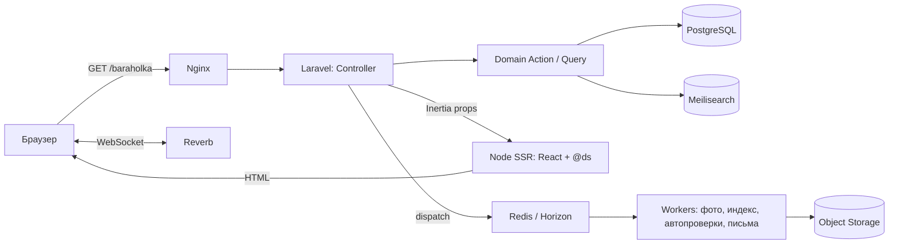

# Архитектура

## 1. Стек

| Слой | Выбор | Зачем |
|---|---|---|
| Бэкенд | Laravel 12, PHP 8.3 | Очереди, события, вход, Scout, Reverb — из коробки |
| Фронт | Inertia.js 2 + React 18 + TypeScript, SSR (`@inertiajs/react` + `ssr.tsx`) | Компоненты ДС — React, подключаются без переноса; SSR для SEO |
| Сборка | Vite 5 + `laravel-vite-plugin` | |
| UI | `resources/js/ds` — копия дизайн-системы (React-исходники + токены), алиас `@ds` | Обновление ДС = `npm run ds:sync` |
| Консоль сотрудников | Filament 3 (`/console`) | Модерация и админка за дни; отличие от макетов `Админ - *` зафиксировано в `design/DEVIATIONS.md` |
| БД | PostgreSQL 16 | Транзакции, `jsonb`, частичные индексы |
| Поиск | Laravel Scout + Meilisearch 1.x | Фасеты, опечатки, русская морфология, геофильтр |
| Очереди | Redis 7 + Laravel Horizon | Фото, индексация, автопроверки, письма, истечение предложений |
| Realtime | Laravel Reverb + Echo | Чат, статусы предложений, счётчик непрочитанных |
| Вход | Laravel Socialite + `socialiteproviders/yandex` (Яндекс ID) и свой вход по коду из письма; Laravel Fortify — сессии и 2FA сотрудников | Почта — идентификатор аккаунта; Яндекс ID привязывается по почте |
| Права | spatie/laravel-permission | Роли сотрудников, ограничения пользователей |
| Журнал | spatie/laravel-activitylog (только запись) | BR-07 |
| Фича-флаги | Laravel Pennant | Скрытие элементов вне MVP, постепенная выкатка |
| Файлы | S3-совместимое хранилище в РФ (Yandex Object Storage / VK Cloud, уточнить) + CDN | 152-ФЗ |
| Изображения | Intervention Image 3 в очереди: 1:1 и 4:3, WebP + AVIF, удаление EXIF | |
| Почта | SMTP-провайдер в РФ (уточнить у OWNER до выкатки входа на stage), Laravel Mail + Markdown-шаблоны; local и CI — Mailpit / `array` | Код входа уходит письмом — провайдер на критическом пути |
| Ошибки | Sentry (PHP + JS) | |
| Тесты | Pest 3 (+ `arch()`), Vitest + Testing Library, Playwright (+ axe, визуальные сравнения), k6 | |
| Качество | Pint, Larastan 8, ESLint (typescript-eslint, react, jsx-a11y), Prettier, `tsc --noEmit` | |

## 2. Структура репозитория

```
app/
  Domain/
    Accounts/      User, EmailLogin (коды), YandexLogin (OAuth), Consent, Profile, Restrictions
    Catalog/       Category, InstrumentModel, City
    Listings/      Listing, ListingPhoto, ListingStatus (enum), ListingStateMachine, SaleRecord, Actions/*
    Search/        ListingSearch (Scout), Facets, SavedSearch
    Messaging/     Conversation, Message, Events/*
    Offers/        Offer, OfferStatus, OfferStateMachine, Jobs/ExpireOffers
    Favorites/
    Moderation/    AutoChecks/*, ModerationDecision, Reasons
    Support/       Complaint, Ticket, HelpArticle
    Notifications/ Notifications/*, Mail/*
  Http/Controllers/  (тонкие, по экрану)  Http/Requests/  Http/Resources/
  Filament/          консоль: Resources/*, Pages/*
  Providers/
resources/
  js/
    ds/            ← копия дизайн-системы (НЕ ПРАВИТЬ, обновляет tools/ds-sync.mjs)
    Components/    композиции на компонентах ДС: SiteHeader, MobileTabBar, CitySelect, OfferCard, PhotoUploader…
    Layouts/       PublicLayout (SiteHeader + Footer ДС), AccountLayout
    Pages/         Home, Flea/Index, Lot/Show, Seller/Show, Sell/*, Messages/*, Account/*, Help/*, Errors/*
    lang/ru.ts     тексты фронта
    app.tsx  ssr.tsx
  css/app.css      импорт токенов ДС в порядке из DESIGN-SYSTEM.md §2
lang/ru/           тексты бэкенда, письма
database/migrations  factories  seeders (данные из прототипов)
tests/
  Unit/  Feature/  Arch/              (Pest)
  js/                                 (Vitest)
  e2e/  UC-*.spec.ts  visual/*.spec.ts  copy.spec.ts  a11y.spec.ts   (Playwright)
design/            макеты, эталоны, ДС (из стартового пакета)
docs/  tools/  .github/
```

## 3. Поток запроса



## 4. Подключение дизайн-системы

- `tools/ds-sync.mjs` копирует `design/ds/components/**/*.{jsx,js,d.ts}` и `design/ds/tokens/*.css` в `resources/js/ds/` и генерирует `resources/js/ds/index.ts`, который реэкспортирует все компоненты (`export * from './commerce/ListingCard.jsx'` …).
- В `vite.config.ts` и `tsconfig.json` — алиас `@ds` → `resources/js/ds`. Импорт: `import { ListingCard, Button } from '@ds'`.
- Исходники ДС — ESM `.jsx` с `import React from "react"`. Vite собирает их вместе с приложением, отдельный бандл не нужен.
- Обновление ДС: новая выгрузка → `design/ds/` → `npm run ds:sync` → визуальные тесты покажут все изменения. Это отдельный PR `chore(ds): sync`.
- Тексты внутри компонентов ДС, которые нарушают словарь (`AGENTS.md §5`), — например «Продать гир» в `Header`. Такие компоненты не используем. Если без компонента не обойтись — передаём текст пропсом, а e2e-тест `copy.spec.ts` проверяет отрисованный DOM.

## 5. Поиск

Индекс `listings` в Meilisearch, только `published`. Поля поиска: `title`, `model`, `brand`, `description`. Фильтры: `category_path`, `condition`, `price`, `city_id`, `ship`, `negotiable`, `_geo`. Сортировки: `published_at:desc`, `price:asc`, `price:desc`, `_geoPoint`. Синхронизация — событие смены статуса → job `SyncListingToIndex`; задержка ≤ 60 с. Ночная сверка БД и индекса (03:30, сверяет id). Синонимы — через поле документа `aliases`, а не настройку `synonyms` Meilisearch (на 1.10 не работала, решение PR #107). Документ собирается из явного белого списка полей; серийный номер, почта, `user_id`, `final_price` в индекс не попадают.

## 6. Realtime

Каналы: `private-user.{id}` (непрочитанные, уведомления), `private-conversation.{id}` (сообщения, предложения). Авторизация канала — Policy. События — `ShouldBroadcast` в очереди.

## 7. Безопасность

- Сессии — cookie `HttpOnly`, `Secure`, `SameSite=Lax`. CSRF — стандартный Laravel. CSP — nonce для Inertia, без `unsafe-inline` в скриптах.
- Вход по почте: код 6 цифр, хэш в Redis, TTL 10 мин (уточнить), 5 неверных попыток с одного IP — блок 15 мин для пары почта+IP, общий потолок 30 неверных в час на почту — блок 1 ч (решение OWNER 03.11.2026). Rate-limit (`RateLimiter`): коды входа — 5 в час на адрес и 20 на IP; сообщения — 30 в минуту; новые объявления — 10 в сутки (уточнить).
- Загрузки: MIME по содержимому, размер ≤ 15 МБ, перекодирование всегда (исходник не отдаётся).
- Доверенные прокси — `app/Providers/TrustedProxiesServiceProvider.php` (`TrustProxies::at`); сейчас только `127.0.0.1` (stage без прокси/CDN, решение OWNER 03.11.2026). CSP с nonce — задача 0.1.13.
- OAuth Яндекса: `state` и PKCE, redirect URI — только из конфига; почта из Яндекс ID считается подтверждённой (`default_email`), без почты — подтверждение кодом. Токены Яндекса не храним, только `yandex_id`.
- Публикация без премодерации — флаг Pennant `premoderation` (выключен до G2); автопроверки работают всегда.
- Консоль `/console`: отдельный guard `staff`, 2FA обязательна, доступ по IP-списку — опционально (уточнить).

## 8. Окружения

| Окружение | Назначение | Выкатка |
|---|---|---|
| local | Docker Compose: pgsql, redis, meilisearch, mailpit, minio | — |
| ci | сервисы GitHub Actions | на каждый PR |
| stage | приёмка, демо OWNER | автоматически из `main` |
| production | пользователи | по тегу `v*` с подтверждением OWNER |

## 9. Переменные окружения

`APP_*`, `DB_*`, `REDIS_*`, `SCOUT_DRIVER=meilisearch`, `MEILISEARCH_HOST`, `MEILISEARCH_KEY`, `REVERB_APP_ID`, `REVERB_APP_KEY`, `REVERB_APP_SECRET`, `AWS_*` (S3-совместимое), `MAIL_*`, `YANDEX_CLIENT_ID`, `YANDEX_CLIENT_SECRET`, `YANDEX_REDIRECT_URI`, `YANDEX_OAUTH_FAKE` (подменный провайдер Яндекс ID только для `testing` и `e2e`), `SENTRY_LARAVEL_DSN`, `VITE_SENTRY_DSN`, `SCOUT_DRIVER=meilisearch`, `SCOUT_QUEUE` (индексация через очередь), `SCOUT_PREFIX` (префикс индексов окружения), `LOGIN_CODE_STORE` (хранилище кодов входа, по умолчанию `redis`), `LOGIN_CODE_FAKE` (фиксированный код только для `testing` и `e2e`), `DS_SHOWCASE` (витрина `/_ds`: по умолчанию включена только в local и stage, в production закрыта всегда; в CI e2e — `true`). Каждая новая переменная добавляется сюда и в `.env.example` в том же PR.
