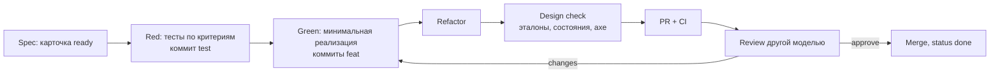

# SDD + TDD — как выполняется задача

## 1. Цикл

## 2. Spec — карточка как контракт

Карточка — единственный источник объёма. Исполнитель:
- читает карточку, эпик, UC в `SPEC.md`, макет и эталоны;
- если критерий непроверяемый или противоречит SPEC — не угадывает, а пишет вопрос в PR (`status:question`) и останавливается;
- не добавляет поведение, которого нет в критериях.

Формат критерия: наблюдаемое поведение с конкретными значениями — «при 2 фото кнопка "Опубликовать" неактивна, над ней текст "добавьте: ещё 1 фото"». Не «форма удобная».

## 3. Red — какие тесты писать

| Что проверяем | Тест | Где |
|---|---|---|
| Доменное правило, переход статуса, расчёт | Pest unit | `tests/Unit/Domain/...` |
| HTTP, права, валидация, очереди, события | Pest feature (`RefreshDatabase`, `Queue::fake`, `Event::fake`) | `tests/Feature/...` |
| Архитектурные запреты | Pest `arch()` | `tests/Arch/` |
| Поведение компонента на странице | Vitest + Testing Library | `tests/js/...` |
| Сценарий пользователя (UC) | Playwright, файл `UC-{id}.spec.ts` | `tests/e2e/` |
| Соответствие макету | Playwright `toHaveScreenshot` против эталона | `tests/e2e/visual/` |
| Доступность | `@axe-core/playwright` на каждом экране | `tests/e2e/a11y.spec.ts` |
| Тексты | `copy.spec.ts`: в DOM нет запрещённых слов | `tests/e2e/copy.spec.ts` |

Правила:
- Каждый критерий приёмки → минимум один тест. В PR — таблица «критерий → тест».
- Тесты коммитятся **до** реализации отдельным коммитом. Ревьюер проверяет порядок коммитов.
- Для state machine — тест на каждый допустимый переход и минимум на один недопустимый.
- Внешние сервисы (OAuth Яндекса, S3, почта, Meilisearch в unit) — только через интерфейсы и подмены на границе. Meilisearch в feature- и e2e-тестах — настоящий, из сервисов CI.
- Данные — фабрики и сиды с примерами из прототипов: Fender ’57 Stratocaster за 184 500 ₽, Москва и т. д.

## 4. Green и Refactor

- Минимальный код до зелёных тестов, затем чистка. Новые тесты на рефакторинг не нужны, старые не трогаются.
- Покрытие доменного слоя (`app/Domain`) — ≥ 90 % строк; общее — ≥ 75 %. CI падает ниже порога.

## 5. Design check (для задач с `prototype`)

1. Открыть макет `design/prototypes/{prototype}` и эталоны `design/screens/{id}@1440.png`, `@390.png`.
2. Собрать экран только из компонентов `@ds` и `resources/js/Components`.
3. Прогнать `npm run test:visual -- --grep {screen-id}`. Порог — `DESIGN-SYSTEM.md §6`.
4. Проверить 8 состояний каждого интерактивного элемента (default, hover, focus, active, disabled, loading, error, success) — где состояние применимо.
5. axe без serious/critical, клавиатурная навигация по экрану.
6. Отличие, которое нельзя устранить (нет данных, вне MVP, ограничение Filament), — в `design/DEVIATIONS.md` с причиной; подтверждает OWNER на гейте.

## 6. Сессия агента

`node tools/docs-ops.mjs session N.M.K` создаёт `docs/operations/sessions/YYYY-MM-DD-N.M.K.md`. Заполняется в конце: сделано, решения, вопросы, что осталось.
