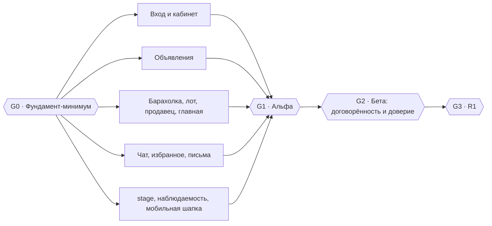
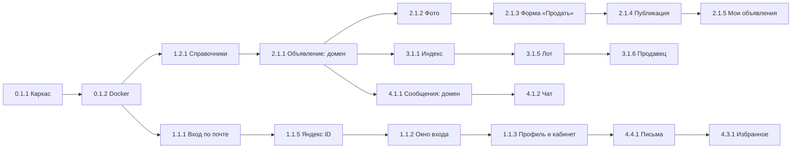

# Роадмап MVP «Барахолка»

Версия 2 · 02.11.2026 · приоритеты OWNER: главная, Барахолка, лот, вход (Яндекс ID и код на почту), кабинет покупателя и продавца, чат по кнопке «Написать», подача объявлений. Всё это — гейт G1. Остальной объём MVP не меняется и идёт после него.

## Решения OWNER (02.11.2026)

| Тема | Решение | Где учтено |
|---|---|---|
| Вход | Яндекс ID + код на почту; без телефона, SMS и паролей; почта — идентификатор | SPEC UC-A1, ARCHITECTURE §1 и §7, 1.1.1, 1.1.5, 1.1.2 |
| Первый вход | Имя, город, согласие с правилами и политикой ПДн — шаг в окне входа | 1.1.1, 1.1.2 |
| Модерация | Публикация сразу после автопроверок; премодерация — флаг `premoderation`, включается в G2 | SPEC §5 и §6.1, 2.1.1, 2.1.4, 5.1.1 |
| Кабинет | Один аккаунт; навигация «Покупаю» / «Продаю» | 1.1.3, design/DEVIATIONS.md |
| Чат | Сообщения + realtime (Reverb) + письмо о новом сообщении в G1; предложение цены — G2 | 4.1.1–4.1.3, 4.4.1 |
| Избранное, страница продавца | В G1 | 4.3.1, 3.1.6 |
| Поиск | Meilisearch | 3.1.1 |
| Фундамент | Минимум до экранов; stage и наблюдаемость — параллельно в G1, каркас консоли — в G2 | 0.1.4, 0.1.5, 0.2.5 |

**Уточнить у OWNER:** почтовый провайдер (нужен до выкатки входа на stage); значения `YANDEX_CLIENT_ID` / `YANDEX_CLIENT_SECRET` в GitHub Secrets (вводит OWNER на этапе 0.3.1).

## Гейты

| Гейт | Цель | Задач |
|---|---|---|
| G0 · v0.1.0 | Фундамент-минимум: каркас, Docker, CI, ДС, эталоны, шапка и подвал | 9 |
| G1 · v0.2.0 · Альфа | Приоритет OWNER: вход, подача объявлений, Барахолка, лот, продавец, главная, кабинет, чат, избранное | 28 |
| G2 · v0.3.0 · Бета | Предложение цены, сохранённые поиски, центр уведомлений, модерация и консоль, жалобы, помощь, SEO; включение `premoderation` | 16 |
| G3 · v1.0.0 · R1 | Мобильная полировка, качество, безопасность, production, запуск | 11 |
| | **Всего** | **64** |

Номер задачи `N.M.K` по-прежнему указывает фазу и эпик (тематику), а очередность задаёт поле `gate`. Задачи разных фаз внутри одного гейта идут параллельно, насколько позволяют `depends_on`. Оркестратор берёт до 3 задач одновременно (ORCHESTRATOR.md §1).

## G0 — Фундамент-минимум

0.1.1 Каркас · 0.1.2 Docker · 0.1.3 CI · 0.1.6 Фича-флаги · 0.2.1 Дизайн-система · 0.2.2 Проверка текстов · 0.2.3 Эталоны · 0.2.4 Шапка и подвал · 0.3.1 GitHub.

## G1 — Альфа: приоритет OWNER

| Поток | Задачи | Экраны |
|---|---|---|
| Вход и кабинет | 1.1.1 Вход по коду на почту → 1.1.5 Яндекс ID → 1.1.2 Окно входа → 1.1.3 Профиль и кабинет; 1.1.4 Город | header (окно входа), account |
| Справочники | 1.2.1 Справочники → 1.2.2 Подсказка модели | — |
| Объявления | 2.1.1 Домен → 2.1.2 Фото → 2.1.3 Форма → 2.1.4 Публикация → 2.1.5 Мои объявления; 2.1.6 Лимит; 5.1.1 Автопроверки | sell, account (listings) |
| Барахолка и просмотр | 3.1.1 Индекс → 3.1.2–3.1.3 Барахолка → 3.1.4 Главная; 3.1.5 Лот → 3.1.6 Продавец | home, flea, flea-empty, lot, seller |
| Общение | 4.1.1 Сообщения: домен → 4.1.2 Чат; 4.1.3 Антиспам; 4.4.1 Письма; 4.3.1 Избранное | messages, account (favorites), emails |
| Инфраструктура (параллельно) | 0.1.4 stage → 0.1.5 Логи и Sentry; 6.1.1 Мобильная шапка | header@390 |

Адаптив ≥ 320 px делается в каждом экране сразу (DoD: 1440 и 390 px); 6.1.2 в G3 — только общий проход.

## Критический путь

Два равных по длине пути: «объявления» (1.2.1 → 2.1.5) и «вход → кабинет → избранное» (1.1.1 → 4.3.1). Их задачи `risk: high` (1.1.1, 1.1.5, 2.1.1, 2.1.2, 4.1.1) идут по одной, но разные пути — параллельно. Задержка задачи на пути сдвигает G1, и оркестратор сообщает об этом OWNER в отчёте.

## G2 — Бета: договорённость и доверие

4.2.1–4.2.2 Предложение цены · 4.3.2 Сохранённые поиски · 4.4.2 Центр уведомлений · 0.2.5 Каркас консоли · 5.3.1–5.3.5 Консоль · 5.1.2–5.1.3 Модерация (вместе с включением `premoderation`) · 5.2.1–5.2.3 Жалобы, помощь, обращения · 3.1.7 SEO.

## G3 — Запуск R1

Без изменений: 6.1.2, 6.2.1–6.2.3, 6.3.1–6.3.3, 6.4.1–6.4.4.

## Оценка (уточнить после G0)

Ориентир при 3 параллельных исполнителях: G0 — 1,5–2 недели, G1 — 6–7, G2 — 3–4, G3 — 3–4. Реальную скорость оркестратор считает по закрытым задачам G0 и пересчитывает прогноз в отчёте OWNER.

## После R1

Каталог новых товаров и компании → тарифы и баллы → мастера и проверка перед покупкой → цены продаж и страница модели → аксессуары. Макеты уже есть (design/screens/manifest.json → `postMvp`), флаги заведены в 0.1.6.
